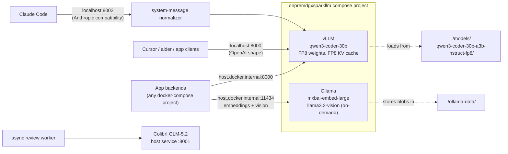

# Architecture

This repo deploys a self-contained on-prem LLM stack tuned for a single
NVIDIA DGX Spark workstation (Blackwell GB10, 128 GB UMA, SM 12.1,
memory bandwidth 273 GB/s).

The current production mode is the co-resident hybrid profile: Qwen uses a
64k, single-sequence memory budget for interactive coding, while GLM-5.2 runs
as a bounded asynchronous verifier. The 256k/four-sequence figures later in
this document describe the standalone vLLM profile.

## Topology

## Why this composition

### vLLM for chat / coding / agent traffic

- Continuous batching + PagedAttention give linear scaling out to
  `--max-num-seqs` concurrent in-flight sequences.
- Prefix caching dramatically reduces TTFT when several agents share a
  long system prompt (Claude CLI's ~28 K-token preamble repeats every
  request).
- Serves both `/v1/chat/completions` (OpenAI) and `/v1/messages`
  (Anthropic). Claude Code goes through the port-8002 compatibility proxy;
  Cursor, aider, and in-house OpenAI clients use port 8000 directly.
- Native `qwen3_coder` tool-call parser allows agentic frameworks to
  bind directly to the model's training format.

### Ollama, but only for embeddings + vision OCR

- vLLM does not currently expose an embedding API surface, and the
  vision OCR fallback we use (`llama3.2-vision:11b`) only ships via
  Ollama. So Ollama stays online, but its previous role as a
  Qwen3-Coder server has been retired.
- Embedding model: `mxbai-embed-large` (1024-dim, state-of-the-art for
  RAG over OCR'd PDFs).

## Model selection: Qwen3-Coder-30B-A3B-Instruct-FP8

Survey across the latest open-source coding models that fit on a single
GB10 with FP8 weights:

| Model | Type | Disk (FP8) | SWE-Bench Verified | Verdict |
|---|---|---|---|---|
| **Qwen3-Coder-30B-A3B-Instruct-FP8** (chosen) | MoE 30B/3B | ~30 GB | ~60% | Fast single-stream (MoE only scans 3 B params/token on a bandwidth-bound machine), Apache 2.0, native `qwen3_coder` tool calls, 256K context, headroom for 8-16 concurrent agents |
| Devstral-Small-2-24B-Instruct-2512 (FP8) | Dense 24B | ~24 GB | 68.0% | +8 SWE-Bench points, but dense -> ~11 tok/s single-stream on Spark; only worth it for "1-2 agents on harder tickets" |
| Qwen3-Next-80B-A3B-Instruct-FP8 | MoE 80B/3B | ~80 GB | (generalist) | Tight fit; ~45 tok/s; not coder-tuned |

The trillion-class 2026 leaders (DeepSeek V4-Pro 1.6 T, DeepSeek V3.2-Exp
671 B, Kimi K2.6 ~1 T, GLM-5.1 744 B, Qwen3-Coder-480B, Devstral 2
123 B, Qwen3-Coder-Next 80 B BF16-only) all need 200 GB+ or multi-GPU
and are off the table for DGX Spark.

**Why MoE 30 B-A3B over the denser 24 B Devstral**: Spark is
memory-bandwidth-bound at 273 GB/s. A dense 24 B FP8 model scans ~24 GB
per token (theoretical max ~11 tok/s); the MoE 30 B-A3B FP8 scans only
~3 GB per token (theoretical max ~91 tok/s). Interactive responsiveness
under 2-3 simultaneous Claude CLI / Cursor agents wins over the +8 %
SWE-Bench delta. The MoE model also leaves ~60 GB of UMA free for KV
cache, supporting the configured 8 concurrent sequences at 64K context.

## Image selection: driver gates the choice

Two viable vLLM images, picked by the host NVIDIA driver:

| Host driver | Image | Notes |
|---|---|---|
| **>= 590.44** | `nvcr.io/nvidia/vllm:25.12.post1-py3` | NVIDIA's Spark-tuned build. Ships precompiled sm_121 binaries for CUTLASS FP8 GEMM, FlashInfer, and FlashAttention. V1 engine + CUDA-graph capture works natively (no `--enforce-eager`). Enables FlashInfer MoE FP8 + FLASH_ATTN. |
| **< 590.44** (current host: 580.95.05) | `vllm-patched:qwen3.5` (from [Dockerfile.vllm-patch](../Dockerfile.vllm-patch)) | Upstream `vllm/vllm-openai` + locally-applied sm_121 source patch (`cutlass_block_fp8_supported -> False`) and runtime flags (`--enforce-eager`, `VLLM_ATTENTION_BACKEND=TRITON_ATTN`). Single-stream throughput is ~30% lower but the stack works on the older driver. |

## sm_121 history (why the patches exist)

When we first attempted this migration on driver 580.x with upstream vLLM:

1. **CUDA-graph capture crash**: `torch.compile + Inductor` raised
   `RuntimeError: Error Internal` during the warm-up profile run because
   PyTorch in the upstream image only emits sm_120 binaries.
   *Workaround*: `--enforce-eager`.
2. **CUTLASS FP8 dense GEMM crash**: `_C.cutlass_scaled_mm` did the same
   thing on FP8 weight loads.
   *Workaround*: source-patch
   `vllm/model_executor/layers/quantization/utils/w8a8_utils.py` so
   `cutlass_block_fp8_supported()` returns `False`, redirecting FP8
   dense GEMM through Triton.
3. **FlashInfer attention crash**: precompiled FlashInfer kernels
   complained "no kernel image available for sm_121".
   *Workaround*: `VLLM_ATTENTION_BACKEND=TRITON_ATTN`, which JIT-compiles
   the attention kernel for sm_121.

All three drop away once the host moves to driver >= 590.44 and the
`nvcr.io/nvidia/vllm:25.12.post1-py3` image, which ships sm_121 binaries
for every one of these kernels.

## Tuning trade-offs

### `--max-model-len` vs `--max-num-seqs`

The KV cache budget on Spark (with `--gpu-memory-utilization 0.70`) is
about 55 GB after subtracting model weights (~30 GB). KV cache per
sequence at FP8 is roughly 96 KB/token for Qwen3-MoE.

| max-model-len | KV per seq | max sequences in 55 GB |
|---|---|---|
| 32768 | 3.1 GB | ~17 |
| 65536 | 6.3 GB | ~8 |
| 131072 | 12.6 GB | ~4 |
| 262144 | 25.2 GB | ~4 (current; vLLM-measured ~4.35x, prefix-caching adds effective headroom) |

Earlier we ran with 65K context, but Claude Code (v2.x) hard-codes
`max_tokens=32000` per request and a long session can grow the input
side beyond 33 K, at which point vLLM (correctly) rejects the request
with HTTP 400. Ollama silently truncates in that case, which is why
this only became visible after the migration. Provisioning the full
256 K native window removes the failure mode entirely; the cost is the
concurrent-sequence drop from 8 to 4, which is still sufficient for
2-3 simultaneous Claude CLI / Cursor agents on this workstation.

### `--enforce-eager` vs CUDA graphs

`--enforce-eager` skips graph capture entirely. On the patched image
this is non-negotiable. The cost is ~30 % single-stream throughput
(measured: ~38 tok/s here vs. an extrapolated ~70-90 tok/s on the nvcr
image with native graphs + FlashInfer MoE FP8 + FlashAttention).

### KV cache dtype

`fp8` (`e4m3`) halves KV memory vs. BF16. We've measured no observable
quality regression with Qwen3-Coder; the upstream Qwen team explicitly
ships and recommends FP8 KV cache for this model.

## See also

- [VLLM_MIGRATION.md](VLLM_MIGRATION.md) - operational guide (setup, tuning, troubleshooting, Claude CLI recipe)
- [../Dockerfile.vllm-patch](../Dockerfile.vllm-patch) - the patched-image build recipe
- [../scripts/migrate_to_vllm.sh](../scripts/migrate_to_vllm.sh) - lifecycle CLI
